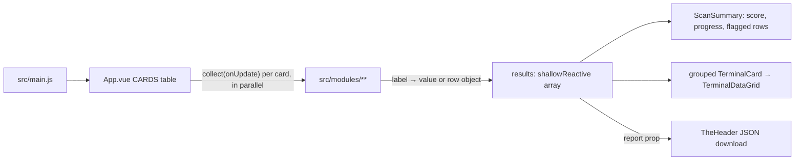

# Repository Guidelines

## Project Overview
What You Reveal is a client-side browser fingerprinting and privacy demo built with Vue 3 and Vite. Every check runs in the browser and nothing is stored on a server. The only network calls are to third-party services needed to show the user's network identity: `api.ipify.org` / `api6.ipify.org` (public IPv4/IPv6), `ipapi.co` with `get.geojs.io` as fallback (GeoIP), `onionoo.torproject.org` (Tor exit lookup) and `stun:stun.cloudflare.com:3478` (WebRTC STUN), plus same-origin latency probes to `/robots.txt`. It is deployed on Vercel at `what-you-reveal.vercel.app`.

## Architecture & Data Flow

- `src/App.vue` is the orchestrator. `CARDS` is one array of `{ title, group, collect, loading, error }` in display order (`'0. PRIVACY_MODE'` … `'14. INTEGRITY_CHECK'`); each card gets an `anchor` id derived from its title. `GROUPS` renders them under four section headings. `results[i]` is `null` (nothing yet), the `ERROR` symbol (collector rejected) or the rows object (possibly partial); `done[i]` marks a finished collector. Card state is `loading` / `error` / `done`.
- **UI layout:** header → `ScanSummary` (headline score from the privacy card, the scan progress, every flagged row grouped by card with links to `#anchor`, and the two dialog triggers) → grouped cards. A flagged row = `warning: true`. It is shown with a `!` gutter marker as well as color, so it survives forced-colors mode. The about/FAQ section and the footer are static HTML in `index.html`.
- **Errors:** a rejected collector becomes `ERROR` and is logged. Inside modules, expected failures are returned as row values (`'Blocked'`, `'Not Supported'`, `'Check Failed (…)'`), not thrown. A check that could not run must never be shown as a negative result (see `tor.js` `error`, `privacy.js` rows).
- **Incremental updates:** every collector receives `onUpdate`; `collectNetworkData` uses it, calling it with a fresh merged copy after each section, then resolves with the full result.
- **Shared, cached lookups** (one request per page load, failed lookups evicted so the next caller retries): `utils/geoip.js` `fetchCachedGeoIP` (normalized shape `{ ip, city, region, country, latitude, longitude, timezone, org, asn, postal, source }`), `utils/publicip.js` `fetchPublicIPs` (`{ v4, v6 }`), `modules/network/webrtc.js` `probeWebRTC`.
- `privacy/privacy.js` `collectPrivacyData` builds the privacy card from `tor.js`, `signals.js`, `webrtc.js`, `fingerprint/canvas.js`, GeoIP `hostingProvider` and `detectincognitojs` (dynamic import, its own chunk). `privacy/score.js` holds `BASE_SCORE = 30`, `SCORE_RULES` and `calculatePrivacyScore`; `ScorePhilosophyPopup` renders the same rules. The `Privacy Score` row carries `summary: { score, grade, factors }`, which the summary panel reads. `PrivacyTipsPopup` uses `factors` to skip tips for protections that are already active (`null` while the checks are still running).
- **State:** no stores, Pinia or composables. State lives in `App.vue` plus the module-level caches above.

## Key Directories
|Path|Purpose|
|---|---|
|`src/modules/fingerprint/`|`identity.js` (canvas/WebGL-canvas/emoji/audio/voices, composite ID), `canvas.js` (canvas protection detection), `webgl.js` (only place GPU details are read), `fonts.js` (metric-based font detection), `intl.js`, `integrity.js` (`detectBot`, sync)|
|`src/modules/network/`|`network.js` (card), `webrtc.js` (shared ICE probe + leak classification)|
|`src/modules/privacy/`|`privacy.js` (card), `score.js`, `signals.js` (DNT/GPC/ad-block bait/Brave), `tor.js` (Onionoo)|
|`src/modules/system/`|navigator APIs, hardware, screen, client hints, media devices/codecs, permissions, clipboard|
|`src/components/`|`ScanSummary`, `TerminalCard` (header status + `container: card` for narrow layouts), `TerminalDataGrid` (two-column rows, collapses past 10 rows only when ≥4 would hide; `element` is structured `{ type: 'image', src, alt }`, never HTML), `BasePopup` (native `<dialog>`), popups, `TheHeader`, `DecryptedText`|
|`src/utils/`|`crypto.js` (`sha256`, `cyrb53`), `geoip.js`, `publicip.js`|
|`src/assets/styles/variables.css`|theme custom properties (terminal look, self-hosted JetBrains Mono via `@fontsource`)|
|`tests/`|`node:test` suites|
|`docs/`|dated verification records, not process docs|
|`public/`|`manifest.json`, icons, `logo.png` (OG image), `robots.txt`, `sitemap.xml`|

## Development Commands
```bash
bun install
bun run dev        # Vite dev server
bun run build      # vite build → dist/
bun run preview
bun run test       # node --test tests/*.test.js
bun run lint       # eslint . (src, tests, config); expected to pass clean
```
- There is no typecheck; the project is plain JavaScript.

## Code Conventions & Common Patterns
- Use Vue 3 `<script setup>` with the Composition API, in plain JavaScript ES modules (`"type": "module"`).
- **Collector contract:** export `async function collectXData(onUpdate?)` returning an object keyed by Title Case labels:
  ```js
  return { 'CPU Cores (Logical)': 8,
           'Do Not Track': { value: 'Enabled', url: 'https://developer.mozilla.org/…', warning: true } };
  ```
  Optional row fields: `url` (usually MDN, rendered as a dotted-underline label link), `warning` (an exposure or a missing protection, not just "unusual"; it feeds the flagged count and summary), `element`, `summary` (privacy score only). Labels must say what the value is; don't claim accuracy the check doesn't have.
- **Adding a card:** write the collector and add one entry to `CARDS` in `App.vue` with a `group` from `GROUPS`. Update the static list in `index.html` (`section.about`) if the card adds a new kind of signal.
- **Naming:** card titles are `'N. SNAKE_CASE'`, modules are lower-case files, imports use explicit `.js` extensions.
- **ESLint:** `globals.browser` for `src/`, `globals.node` for tests/config. Unused variables are errors unless `_`-prefixed; use `catch {}` when the error is unused.
- **Version:** only in `package.json`. `TheHeader` imports it; `vite.config.js` replaces `%APP_VERSION%` in `index.html`.

## Important Files
- `index.html`: SEO/Open Graph tags, two JSON-LD blocks (WebApplication, FAQPage), the visible `section.about` with the check list and FAQ, and the static footer. **The FAQPage JSON-LD must match the visible FAQ text, and the score answer must match `score.js`.**
- `src/assets/styles/variables.css`: tokens (`--fg-dim` 7.4:1, `--fg-muted` 4.9:1 on black; `prefers-contrast: more` overrides). `base.css`: reset, focus ring, `.section-title`, about/footer, the global reduced-motion switch.
- `vite.config.js`: Vue plugin, `%APP_VERSION%` injection, fonts excluded from asset inlining.
- `eslint.config.js`: flat config (`@eslint/js` + `eslint-plugin-vue` flat/recommended).
- `vercel.json`: `bun install` / `bun run build`, CSP (`connect-src` lists exactly the HTTP APIs above; add any new endpoint there), nosniff, `X-Frame-Options: DENY`, referrer policy, 1-year immutable cache on `/assets/*`. No SPA rewrite (there is no router). No `Permissions-Policy`: blocking camera/microphone/geolocation would falsify the media-device and permission cards.

## Runtime/Tooling Preferences
- Bun is the package manager and script runner on Vercel and in the README. The only lockfile is `package-lock.json` (Bun reads it); avoid adding a second lockfile without deciding which one stays.
- Tests run on Node's built-in runner. No `engines` pin, env vars or `.env` files.
- Runtime dependencies: `vue`, `detectincognitojs`, `@fontsource/jetbrains-mono`.

## Testing & QA
- `tests/privacy-network.test.js` (`node:test` + `node:assert/strict`) covers GeoIP fallback/normalization/sharing/retry/stale eviction, hosting-provider classification, Tor via Onionoo (no IP, lookup failure, exact vs prefix match, IPv6, non-exit relays), WebRTC leak classification (per-family, bracketed IPv6, /64 privacy addresses, local IPs) and score clamping.
- **Test pattern:** route `globalThis.fetch` by URL prefix; clear the shared caches (`clearGeoIPCache`, `clearPublicIPCache`); import modules with module-level caches (`tor.js`, `webrtc.js`) with `?scenario=<name>` for a fresh copy; install a fake `globalThis.RTCPeerConnection` for WebRTC.
- No CI (`.github/` only has `FUNDING.yml`). Before handing off, run `bun run test`, `bun run lint` and `bun run build`. For UI or collector changes, check the cards in a real browser (`bun run dev` or `preview`); most collectors need real browser APIs, and headless Chromium reports itself as a bot and a pointer-less device.
